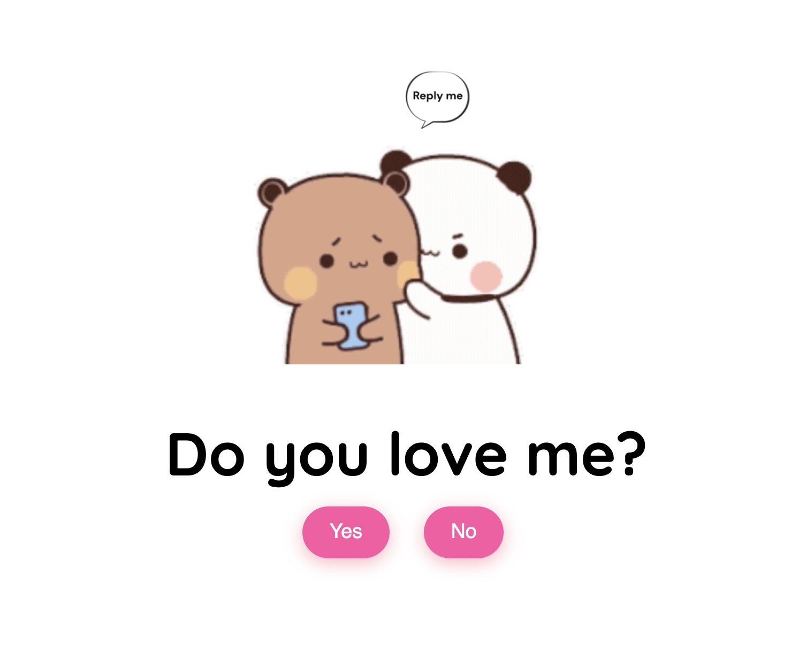

# LoveMeValentine

Небольшая интерактивная валентинка: на странице задается вопрос «Do you love me?», кнопка «No» убегает от курсора, а после нажатия «Yes» появляется финальное видео.



## Запуск

1. Скачайте или клонируйте проект.
2. Откройте `index.html` в браузере.

Для локального запуска через веб-сервер можно выполнить в папке проекта:

```bash
python3 -m http.server 8000
```

Затем откройте <http://localhost:8000>.

## Файлы проекта

- `index.html` — разметка страницы.
- `style.css` — оформление и анимация загрузки.
- `script.js` — поведение кнопок и переход к результату.
- `Reply me love.mp4` — видео на экране с вопросом.
- `Love me.mp4` — видео после нажатия «Yes».
- `image.png` — изображение-предпросмотр в этом README.

Видео должны оставаться в папке проекта: страница загружает их по указанным именам файлов.

# love-me
