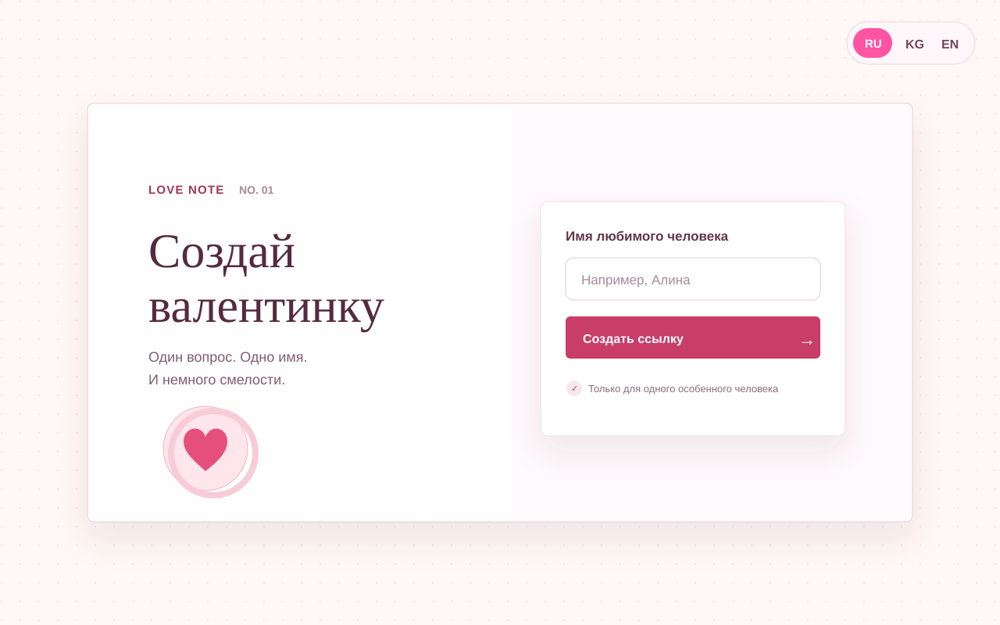

# Love-Me

Создай персональную валентинку: введи имя, выбери русский, кыргызский или английский и отправь готовую ссылку. Получатель увидит персональный вопрос, убегающую кнопку «Нет» и финальное видео после нажатия «Да».



## Запуск

Для локального просмотра скачайте или клонируйте проект и запустите веб-сервер из папки проекта:

```bash
python3 -m http.server 8000
```

Откройте <http://localhost:8000>. Чтобы отправлять ссылки другим людям, сначала опубликуйте проект на веб-хостинге: ссылка, созданная на `localhost` или через `file://`, доступна только на вашем устройстве.

## Файлы проекта

- `index.html` — разметка страницы.
- `style.css` — оформление и анимация загрузки.
- `script.js` — поведение кнопок и переход к результату.
- `preview.svg` — актуальное изображение стартовой страницы для README.
- Выбранный язык сохраняется в браузере.
- `Reply me love.mp4` — видео на экране с вопросом.
- `Love me.mp4` — видео после нажатия «Yes».

Видео должны оставаться в папке проекта: страница загружает их по указанным именам файлов.
